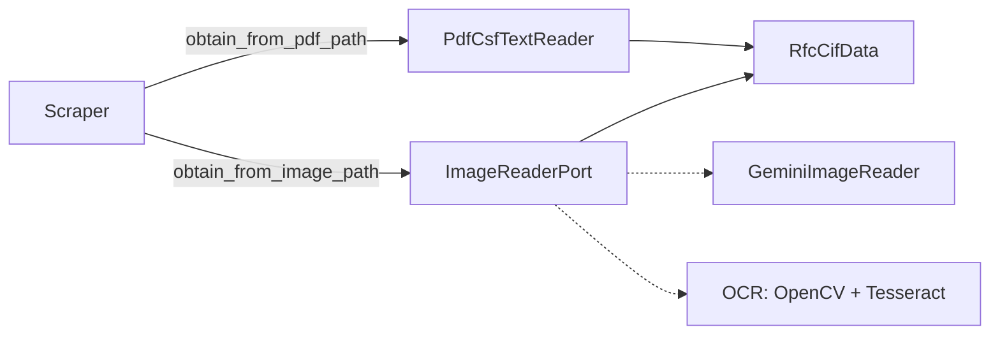

# csf-scraper

Port a Python de [phpcfdi/csf-scraper](https://github.com/phpcfdi/csf-scraper):
obtiene los datos fiscales actuales de una persona moral o física dado su RFC y
su idCIF (SAT, Constancia de Situación Fiscal).

## Requisitos

- Python >= 3.11
- [`pdftotext`](https://poppler.freedesktop.org/) (paquete del sistema
  `poppler-utils`), necesario **solo** para leer la CSF desde un archivo PDF
  (`obtain_from_pdf_path`).
- Dependencias: `httpx`, `beautifulsoup4`, `lxml`, `pydantic`.

## Instalación

Desde el código fuente:

```bash
pip install .
```

## Ejemplo de uso

```python
from csf_scraper import Scraper

scraper = Scraper.create()

# RFC + idCIF directamente (se validan con los value objects Rfc e IdCif)
person = scraper.obtain_from_rfc_and_cif("DIM8701081LA", "1904014102123")

# También puedes obtener los datos directamente de un archivo local PDF
# (requiere pdftotext / poppler-utils instalado)
person = scraper.obtain_from_pdf_path("ruta/al/csf.pdf")

# O de una CSF escaneada (JPEG/PNG), inyectando el motor de lectura de imágenes
from csf_scraper.image_readers.adapters.gemini_image_reader import GeminiImageReader

scraper = Scraper.create(image_reader=GeminiImageReader(api_key="…", model_name="…"))
person = scraper.obtain_from_image_path("ruta/al/csf.png")

# Acceso a los datos de la persona (moral o física) por atributos
if person.is_fisica():
    print(person.nombre)
elif person.is_moral():
    print(person.razon_social)

# Regímenes: lista de Regimen, cada uno con su id ya calculado
for regimen in person.regimenes:
    print(regimen.regimen, regimen.regimen_id, regimen.fecha_alta)

# Los títulos del HTML que no tienen un campo propio se guardan aquí
print(person.extra_data)

# Diccionario de datos (envoltura de model_dump) o JSON (ISO-8601 en fechas)
data = person.to_dict()
json_text = person.model_dump_json()
```

Salida de `person.to_dict()` para una persona moral (fechas como `datetime`):

```python
{
    "rfc": "DIM8701081LA",
    "id_cif": "12345678",
    "fecha_inicio_operaciones": datetime(2019, 2, 21),
    # …
    "regimenes": [
        {
            "regimen": "Régimen General de Ley Personas Morales",
            "fecha_alta": datetime(2019, 2, 21),
            "regimen_id": "601",
        },
    ],
    "extra_data": {"localidad": ""},
    "razon_social": "Mi razón social",
    "regimen_de_capital": "SA DE CV",
    "fecha_constitucion": datetime(2019, 2, 21),
}
```

## Modelos

- `Persona` es la base de `PersonaFisica` y `PersonaMoral`; sus campos se
  exponen como atributos en `snake_case` (`rfc`, `id_cif`, `colonia`, …).
- `rfc: Rfc | None` e `id_cif: IdCif | None` usan los value objects que validan
  el formato tanto al construir como al asignar (pydantic normaliza las cadenas
  automáticamente).
- `is_fisica()` e `is_moral()` permiten distinguir el tipo de persona sin
  inspeccionar el RFC por fuera de la librería.
- `Regimen` se construye con el texto del régimen y, opcionalmente, la fecha de
  alta: `Regimen(regimen="Régimen Simplificado de Confianza", fecha_alta="01-02-2001")`.
  El atributo `regimen_id` se calcula a partir del texto y `fecha_alta` acepta
  cadenas `dd-mm-yyyy` o `datetime`.
- `extra_data` reúne los títulos del HTML que no corresponden a un campo del
  modelo. La correspondencia título → campo está en `Persona.field_titles`.
- `to_dict()` es una envoltura de `model_dump()`; `model_dump_json()` serializa
  las fechas en ISO-8601.

## Value objects

| Value object | Regla                                                                                                                                     |
| ------------ | ----------------------------------------------------------------------------------------------------------------------------------------- |
| `Rfc`        | `3–4 letras` (incluye `Ñ` y `&`) + `6 dígitos` + `3 alfanuméricos`; normaliza espacios/mayúsculas. `is_fisica()` (13) / `is_moral()` (12) |
| `IdCif`      | solo dígitos, longitud 8–13                                                                                                               |
| `CsfImage`   | imagen JPEG o PNG validada por _magic bytes_; expone `as_bytes()`, `as_base64()` y `get_mime_type()`                                      |

Los value objects son subclases de `str`, por lo que se comportan como cadenas,
se serializan como texto plano y lanzan la excepción personalizada
correspondiente si el formato no es válido:

```python
from csf_scraper import InvalidIdCifFormatException, InvalidRfcFormatException, Rfc

rfc = Rfc("  dim8701081la  ")  # → "DIM8701081LA"
rfc.is_moral()  # → True

try:
    Rfc("no-es-un-rfc")
except InvalidRfcFormatException as exception:
    print(exception)
```

## Lectura de CSF

Ambas rutas de extracción (`obtain_from_pdf_path` y `obtain_from_image_path`)
implementan el puerto `RfcCifExtractorPort` y devuelven el DTO `RfcCifData`, de
modo que `Scraper` no conoce el detalle del motor de lectura:



Por omisión `Scraper` solo sabe leer PDFs; el lector de imágenes es **opcional**
y se inyecta con `Scraper.create(image_reader=…)`. Si se invoca
`obtain_from_image_path` sin un lector configurado se lanza
`ImageReaderNotConfiguredException`.

## Excepciones

Todas heredan de `CsfScraperException`:

- `CifDownloadException` (la petición HTTP falló; conserva `url`; la excepción
  original queda encadenada en `__cause__`)
- `CifNotFoundException` (el SAT no devolvió información del CIF)
- `RfcFromPdfNotFoundException` / `CifFromPdfNotFoundException` (el PDF no
  contiene RFC / idCIF)
- `EmptyPdfContentException` / `PdfToTextConvertException` (problemas con
  `pdftotext`)
- `RfcFromImageNotFoundException` / `CifFromImageNotFoundException` (la imagen
  no contiene RFC / idCIF)
- `ImageReaderNotConfiguredException` (se pidió leer una imagen sin inyectar un
  lector)
- `InvalidImageException` / `InvalidImageFormatException` (imagen vacía, ilegible
  o con formato distinto de JPEG/PNG)
- `ImageReadingException` (fallo del motor de lectura de imágenes)
- `InvalidRfcFormatException` / `InvalidIdCifFormatException` (formato inválido
  en los value objects `Rfc` / `IdCif`)

## Desarrollo

```bash
python -m venv .venv
.venv/bin/pip install -e ".[dev]"
.venv/bin/ruff check .
.venv/bin/mypy src
.venv/bin/pytest
```

Los tests usan fixtures de `tests/_files/` y mockean HTTP con `respx`:
**ningún test contacta al SAT**.

## Documentación de la migración

- `docs/migration-map.md`: correspondencia archivo a archivo PHP → Python.
- `docs/differences.md`: diferencias de comportamiento deliberadas.

## Licencia

MIT — ver `LICENSE` (heredado del original) y `NOTICE.md`.
