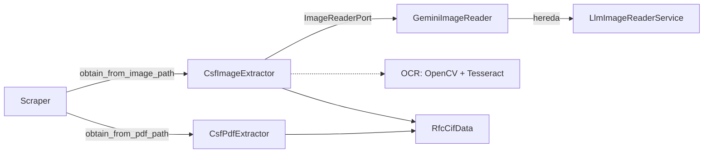

# csf-scraper

Port a Python de [phpcfdi/csf-scraper](https://github.com/phpcfdi/csf-scraper):
obtiene los datos fiscales actuales de una persona moral o física dado su RFC y
su idCIF (SAT, Constancia de Situación Fiscal).

## Requisitos

- Python >= 3.11
- [`pdftotext`](https://poppler.freedesktop.org/) (paquete del sistema
  `poppler-utils`), necesario **solo** para leer la CSF desde un archivo PDF
  (`obtain_from_pdf_path`).
- Dependencias: `httpx`, `beautifulsoup4`, `lxml`, `pydantic`, `llama-index-core`.
  Los clientes de cada proveedor LLM son extras opcionales (`llm-gemini`).

## Instalación

Desde PyPI (solo lectura de CSF por RFC+idCIF y por PDF):

```bash
pip install csf-scraper-python
```

Para leer CSF escaneadas (JPEG/PNG) con Gemini, agrega el extra:

```bash
pip install "csf-scraper-python[llm-gemini]"
```

Desde el código fuente:

```bash
pip install .
```

## Ejemplo de uso

Todo el flujo es asíncrono: `Scraper` envuelve un `httpx.AsyncClient` y todos
los métodos de lectura son corrutinas, así que se consumen con `await`.

```python
import asyncio

from csf_scraper import Scraper


async def main() -> None:
    # El scraper es un context manager asíncrono: cierra el AsyncClient al salir
    async with Scraper.create() as scraper:
        # RFC + idCIF directamente (se validan con los value objects Rfc e IdCif)
        person = await scraper.obtain_from_rfc_and_cif("DIM8701081LA", "1904014102123")

        # También puedes obtener los datos directamente de un archivo local PDF
        # (requiere pdftotext / poppler-utils instalado)
        person = await scraper.obtain_from_pdf_path("ruta/al/csf.pdf")

    # Acceso a los datos de la persona (moral o física) por atributos
    if person.is_fisica():
        print(person.nombre)
    elif person.is_moral():
        print(person.razon_social)

    # Regímenes: lista de Regimen, cada uno con su id ya calculado
    for regimen in person.regimenes:
        print(regimen.regimen, regimen.regimen_id, regimen.fecha_alta)

    # Los títulos del HTML que no tienen un campo propio se guardan aquí
    print(person.extra_data)

    # Diccionario de datos (envoltura de model_dump) o JSON (ISO-8601 en fechas)
    data = person.to_dict()
    json_text = person.model_dump_json()


if __name__ == "__main__":
    asyncio.run(main())
```

Para leer una CSF escaneada (JPEG/PNG) se inyecta el motor de lectura de imágenes.
Requiere el extra `llm-gemini`:

```python
import asyncio

from csf_scraper import CsfImageExtractor, GeminiImageReader, Scraper


async def main() -> None:
    reader = GeminiImageReader(api_key="…", model_name="…")
    async with Scraper.create(image_extractor=CsfImageExtractor(reader)) as scraper:
        person = await scraper.obtain_from_image_path("ruta/al/csf.png")
    print(person.to_dict())


if __name__ == "__main__":
    asyncio.run(main())
```

Salida de `person.to_dict()` para una persona moral (fechas como `datetime`):

```python
{
    "rfc": "DIM8701081LA",
    "id_cif": "12345678",
    "fecha_inicio_operaciones": datetime(2019, 2, 21),
    # …
    "regimenes": [
        {
            "regimen": "Régimen General de Ley Personas Morales",
            "fecha_alta": datetime(2019, 2, 21),
            "regimen_id": "601",
        },
    ],
    "extra_data": {"localidad": ""},
    "razon_social": "Mi razón social",
    "regimen_de_capital": "SA DE CV",
    "fecha_constitucion": datetime(2019, 2, 21),
}
```

## Modelos

- `Persona` es la base de `PersonaFisica` y `PersonaMoral`; sus campos se
  exponen como atributos en `snake_case` (`rfc`, `id_cif`, `colonia`, …).
- `rfc: Rfc | None` e `id_cif: IdCif | None` usan los value objects que validan
  el formato tanto al construir como al asignar (pydantic normaliza las cadenas
  automáticamente).
- `is_fisica()` e `is_moral()` permiten distinguir el tipo de persona sin
  inspeccionar el RFC por fuera de la librería.
- `Regimen` se construye con el texto del régimen y, opcionalmente, la fecha de
  alta: `Regimen(regimen="Régimen Simplificado de Confianza", fecha_alta="01-02-2001")`.
  El atributo `regimen_id` se calcula a partir del texto y `fecha_alta` acepta
  cadenas `dd-mm-yyyy` o `datetime`.
- `extra_data` reúne los títulos del HTML que no corresponden a un campo del
  modelo. La correspondencia título → campo está en `Persona.field_titles`.
- `to_dict()` es una envoltura de `model_dump()`; `model_dump_json()` serializa
  las fechas en ISO-8601.

## Value objects

| Value object | Regla                                                                                                                                     |
| ------------ | ----------------------------------------------------------------------------------------------------------------------------------------- |
| `Rfc`        | `3–4 letras` (incluye `Ñ` y `&`) + `6 dígitos` + `3 alfanuméricos`; normaliza espacios/mayúsculas. `is_fisica()` (13) / `is_moral()` (12) |
| `IdCif`      | solo dígitos, longitud 8–13                                                                                                               |
| `CsfImage`   | imagen JPEG o PNG validada por _magic bytes_; expone `as_bytes()`, `as_base64()` y `get_mime_type()`                                      |

Los value objects son subclases de `str`, por lo que se comportan como cadenas,
se serializan como texto plano y lanzan la excepción personalizada
correspondiente si el formato no es válido:

```python
from csf_scraper import InvalidIdCifFormatException, InvalidRfcFormatException, Rfc

rfc = Rfc("  dim8701081la  ")  # → "DIM8701081LA"
rfc.is_moral()  # → True

try:
    Rfc("no-es-un-rfc")
except InvalidRfcFormatException as exception:
    print(exception)
```

## Lectura de CSF

La librería separa dos responsabilidades que es fácil confundir:

- **Origen**: de dónde salen los datos (una ruta de archivo). Contrato público
  `RfcCifExtractorPort.extract(path) -> RfcCifData`.
- **Motor**: cómo se lee una imagen ya cargada en memoria. Contrato
  `ImageReaderPort.read(image) -> RfcCifData`.

`Scraper` solo habla con `RfcCifExtractorPort`, de modo que no distingue un PDF
(`CsfPdfExtractor`) de una imagen: cualquier extractor que cumpla el contrato
sirve para ambas rutas.



### Contrato de los extractores (`RfcCifExtractorPort`)

```python
class RfcCifExtractorPort(ABC):
    @abstractmethod
    async def extract(self, path: str) -> RfcCifData: ...
```

- El contrato es **asíncrono**: `extract` es una corrutina para que cada
  implementación pueda delegar E/S (procesos externos, disco) sin bloquear el
  bucle de eventos; `Scraper` la consume con `await`.
- La ruta viaja **en el método**, no en el constructor: los extractores son
  sin estado y reutilizables entre archivos.
- El constructor queda reservado para configuración del motor (API key, modelo,
  binario alternativo…).
- Devuelve siempre `RfcCifData` con `rfc: Rfc` e `id_cif: IdCif` ya validados.
- Los adaptadores de la librería reportan sus fallos con `CsfScraperException`;
  las dependencias inyectadas pueden propagar sus propias excepciones.

Implementaciones: `CsfPdfExtractor` (texto de `pdftotext` + `PdfCsfTextParser`)
y `CsfImageExtractor` (puente entre una ruta y cualquier `ImageReaderPort`).

### Contrato de los motores de imagen (`ImageReaderPort`)

```python
class ImageReaderPort(ABC):
    @abstractmethod
    async def read(self, image: CsfImage) -> RfcCifData: ...
```

- Recibe una imagen **en memoria**; nunca abre archivos ni conoce rutas.
- La validación de formato (JPEG/PNG) ocurre al construir `CsfImage`, así que el
  motor puede asumir que la imagen es válida.

### Sub-contrato de los adaptadores basados en LLM

Los adaptadores de Gemini, DeepSeek, etc. heredan de `LlmImageReaderService` e
implementan `ImageReaderPort`. La base aporta el comportamiento común; el
adaptador crea su cliente de LlamaIndex y expone `read()` delegando en el método
plantilla.

```python
class LlmImageReaderService(ABC):
    prompt: ClassVar[str] = CSF_PROMPT
    provider: str  # propiedad abstracta
    model: str

    async def _run_program(
        self, image: CsfImage, llm_provider: LLM
    ) -> RfcCifData:  # plantilla
        ...

    async def _image_to_schema(
        self,
        image_documents: Sequence[ImageBlock],
        retry_prompt: str,
        llm_provider: LLM,
    ) -> RfcCifSchema:
        ...
```

`LlmImageReaderService` solo tiene cuatro responsabilidades:

1. **Armado del prompt**: `CSF_PROMPT` más la realimentación del intento previo.
2. **Armado del mensaje con la imagen**: un único `ImageBlock` con los bytes y
   el MIME type de la `CsfImage`.
3. **Reintentos**: cuando `Rfc` o `IdCif` rechazan el formato de negocio, se
   vuelve a interrogar al modelo pasándole el error como contexto (hasta
   `max_retries`, por omisión `MAX_RETRIES = 3`). Los fallos de transporte _no_
   se reintentan: se envuelven en `ImageReadingException`.
4. **Parseo al DTO**: un `RfcCifSchema` ya tipado se mapea a `RfcCifData`.

| Responsabilidad         | Dónde vive                                                  |
| ----------------------- | ----------------------------------------------------------- |
| Prompt canónico         | constante `CSF_PROMPT` (+ `RETRY_PROMPT`)                   |
| Lectura del archivo     | `CsfImage.new_from_path`, invocado por `CsfImageExtractor`  |
| Forma de la respuesta   | `RfcCifSchema` (`Field` con `description` para el modelo)   |
| Transporte al proveedor | el adaptador crea `llm_provider` y lo pasa a `_run_program` |
| Validación de RFC/idCIF | value objects `Rfc` / `IdCif`                               |
| Mapeo de errores        | `ImageReadingException` y derivadas                         |

Nota: la imagen se lee con `asyncio.to_thread` dentro de `CsfImageExtractor` y
`pdftotext` se ejecuta con `asyncio.to_thread` dentro de `PdfToText`, porque
ambas operaciones son bloqueantes; el resto del flujo (HTTP, LLM) usa APIs
asíncronas.

`RfcCifSchema` es un `BaseModel` cuyos `Field` llevan `description`; esos textos
son los que el modelo multimodal usa para saber qué aspecto tienen el RFC y el
idCIF impresos en la Constancia de Situación Fiscal. Pydantic valida la _forma_
(campos presentes y de tipo `str`) y los value objects validan el _formato de
negocio_, que es justo lo que dispara los reintentos.

El adaptador crea su cliente de LlamaIndex (`GoogleGenAI`) y lo pasa al método
plantilla; `_image_to_schema` construye y ejecuta el
`MultiModalLLMCompletionProgram`:

```python
class GeminiImageReader(LlmImageReaderService, ImageReaderPort):
    def __init__(
        self, api_key: str, model_name: str, *, max_retries: int = MAX_RETRIES
    ) -> None:
        super().__init__(model=model_name, max_retries=max_retries)
        self._llm_provider = GoogleGenAI(api_key=api_key, model=model_name)

    @property
    def provider(self) -> str:
        return "gemini"

    async def read(self, image: CsfImage) -> RfcCifSchema:
        return await self._run_program(
            image=image, llm_provider=self._llm_provider
        )
```

El extra `llm-gemini` instala `llama-index-llms-google-genai`; el resto de la
librería no depende de ningún proveedor.

Por omisión `Scraper` solo sabe leer PDFs; el extractor de imágenes es
**opcional** y se inyecta con `Scraper.create(image_extractor=…)`. Si se invoca
`obtain_from_image_path` sin extractor configurado se lanza
`ImageExtractorNotConfiguredException`.

## Excepciones

Todas heredan de `CsfScraperException`:

- `CifDownloadException` (la petición HTTP falló; conserva `url`; la excepción
  original queda encadenada en `__cause__`)
- `CifNotFoundException` (el SAT no devolvió información del CIF)
- `RfcFromPdfNotFoundException` / `CifFromPdfNotFoundException` (el PDF no
  contiene RFC / idCIF)
- `EmptyPdfContentException` / `PdfToTextConvertException` (problemas con
  `pdftotext`)
- `RfcFromImageNotFoundException` / `CifFromImageNotFoundException` (la imagen
  no contiene RFC / idCIF)
- `ImageExtractorNotConfiguredException` (se pidió leer una imagen sin inyectar
  un extractor)
- `InvalidImageException` / `InvalidImageFormatException` (imagen vacía, ilegible
  o con formato distinto de JPEG/PNG)
- `ImageReadingException` (fallo del motor de lectura de imágenes; conserva
  `provider` y `model`)
- `InvalidRfcFormatException` / `InvalidIdCifFormatException` (formato inválido
  en los value objects `Rfc` / `IdCif`)

## Desarrollo

```bash
python -m venv .venv
.venv/bin/pip install -e ".[dev]"
.venv/bin/ruff check .
.venv/bin/mypy
.venv/bin/pytest
```

Los tests usan fixtures de `tests/_files/` y mockean HTTP con `respx`:
**ningún test contacta al SAT**.

## Documentación de la migración

- `docs/migration-map.md`: correspondencia archivo a archivo PHP → Python.
- `docs/differences.md`: diferencias de comportamiento deliberadas.

## Licencia

MIT — ver `LICENSE` (heredado del original) y `NOTICE.md`.
